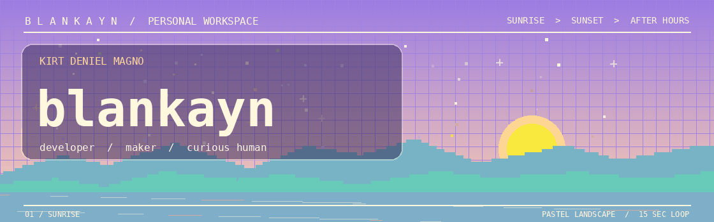
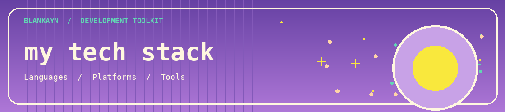
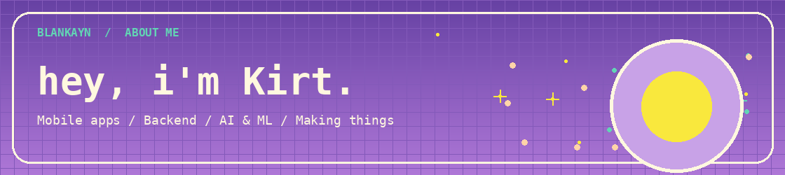
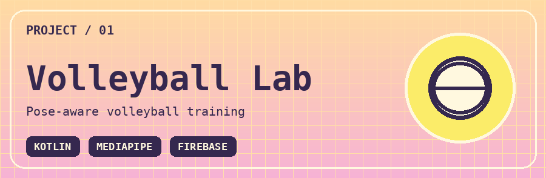
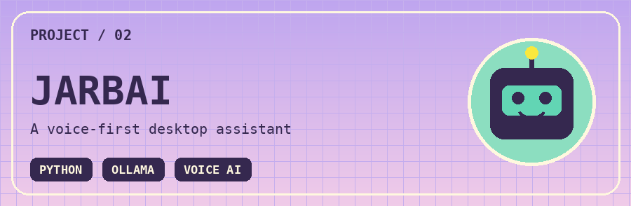
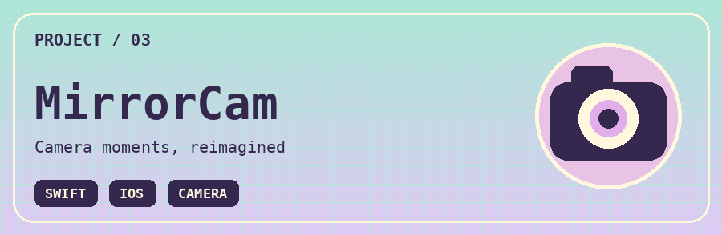
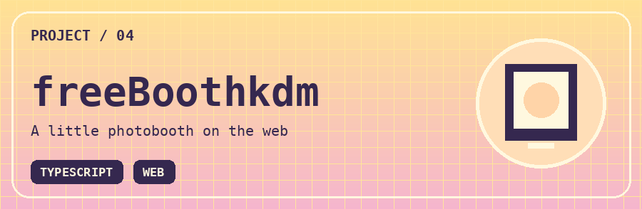

  

  

  
  
  

  

  &nbsp;
  &nbsp;
  &nbsp;
  &nbsp;
  &nbsp;
  

  &nbsp;
  &nbsp;
  &nbsp;
  &nbsp;
  &nbsp;
  

 

  <a href="https://github.com/blankayn?tab=repositories">Explore my projects</a>
  &nbsp; / &nbsp;
  <a href="https://github.com/blankayn/Volleyball-Lab">Volleyball Lab</a>
  &nbsp; / &nbsp;
  <a href="https://github.com/blankayn/JARBAI">JARBAI</a>

 

  

I enjoy building useful, creative software—from mobile apps and camera-based tools to AI assistants. I'm especially interested in backend development and AI/ML.

 

### ✨ Selected work

<table>
  <tr>
    <td valign="top" width="50%">
      
      
Volleyball training with camera-based pose analysis, form feedback, and a connected coach portal.

      <a href="https://github.com/blankayn/Volleyball-Lab">Explore the project →</a>
    </td>
    <td valign="top" width="50%">
      
      
A voice-controlled Windows assistant with a sci-fi dashboard, local and cloud models, and system tools.

      <a href="https://github.com/blankayn/JARBAI">Explore the project →</a>
    </td>
  </tr>
  <tr>
    <td valign="top" width="50%">
      
      
An iOS camera app for iPhone 6, with mirrored selfies, video recording, motion photos, and a built-in gallery.

      <a href="https://github.com/blankayn/MirrorCam">Explore the project →</a>
    </td>
    <td valign="top" width="50%">
      
      
A free online photobooth—a web project built around a simple, playful camera experience.

      <a href="https://github.com/blankayn/freeBoothkdm">Explore the project →</a>
    </td>
  </tr>
</table>

 

  Kirt Deniel Magno &nbsp; / &nbsp; <a href="https://github.com/blankayn">@blankayn</a>

  

